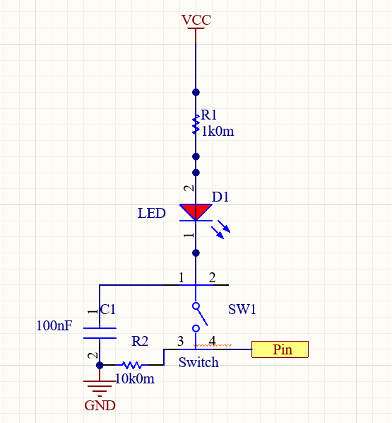
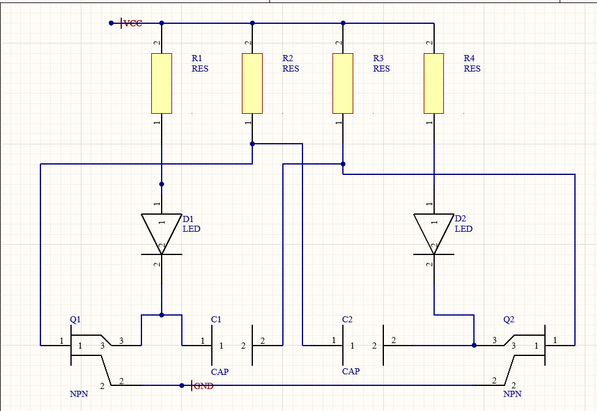
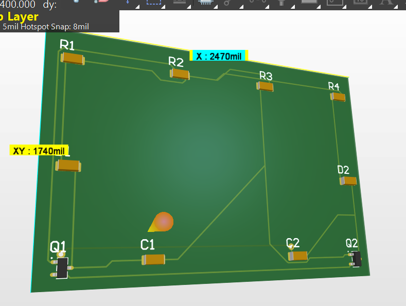

# Altium_Schematic

## Ялинка — мультивібратор на світлодіодах

Старченко Аліна, група Б-123-24-1-СП

Два транзистори утворюють мультивібратор, тому світлодіоди D1 і D2 блимають по черзі.
Схема і плата зроблені в Altium Designer.

### Схема

### Плата 3D

